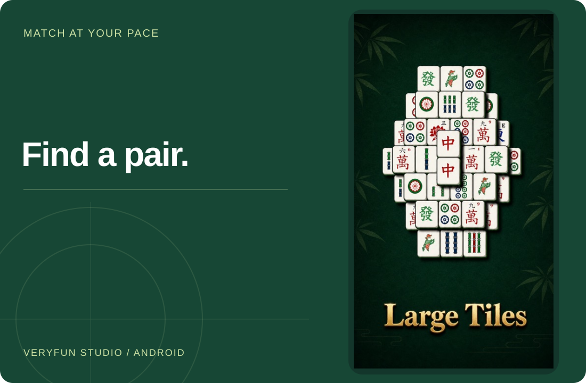
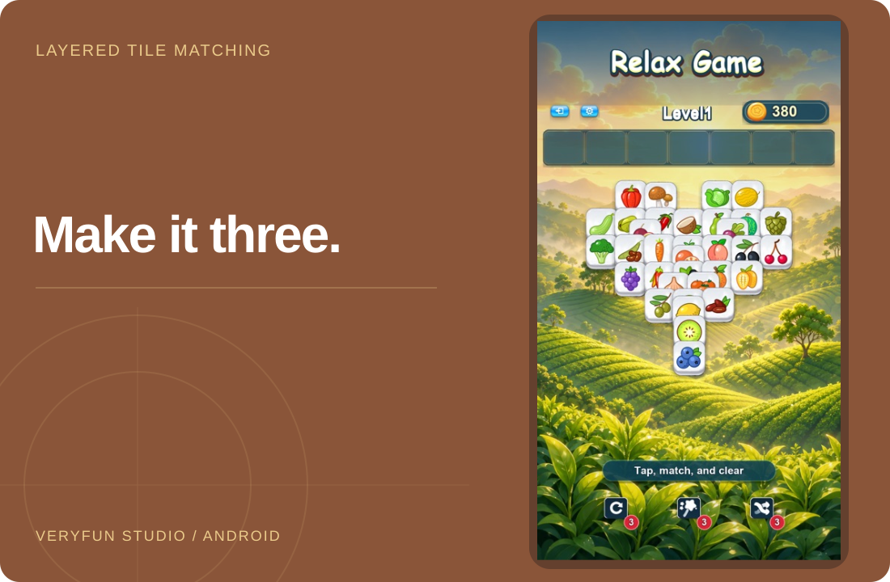
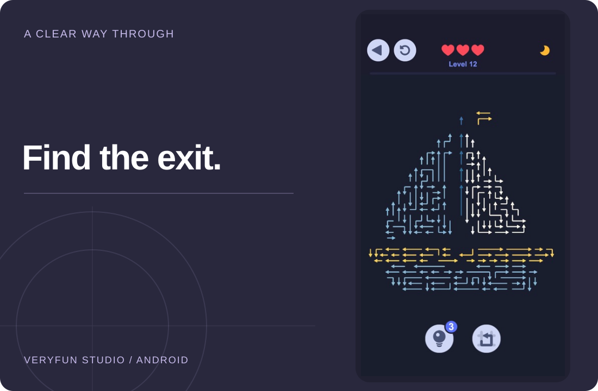

**English** · [简体中文](README.zh-CN.md)

<picture>
  <source media="(max-width: 600px) and (prefers-color-scheme: dark)" srcset="../assets/veryfun-20261029/studio-dark-mobile.svg">
  <source media="(max-width: 600px)" srcset="../assets/veryfun-20261029/studio-light-mobile.svg">
  <source media="(prefers-color-scheme: dark)" srcset="../assets/veryfun-20261029/studio-dark-desktop.svg">
  
</picture>

# VeryFun Studio

We’re an independent puzzle studio making calm, tactile mobile games for the little pauses in your day.

[Visit the studio](https://veryfunstudio.github.io/) · [About us](https://veryfunstudio.github.io/about/) · [Get in touch](https://veryfunstudio.github.io/contact/)

## Three puzzles, three ways to unwind

A selection from our [Android game catalog](https://veryfunstudio.github.io/about/).

[Nova Mahjong](#nova-mahjong-for-seniors) · [Tile Journey](#tile-journey) · [Arrow Out](#arrow-out)

### Nova Mahjong For Seniors

**Mahjong, without the hurry.**

Match large, clear tiles on a green-felt board, with no timer rushing the next move.

[Explore the game](https://veryfunstudio.github.io/games/nova-mahjong/) · [Get it on Google Play](https://play.google.com/store/apps/details?id=com.veryfuncompany.mahjongjourney)

<picture>
  <source media="(max-width: 600px)" srcset="../assets/veryfun-20261029/nova-gameplay.jpg">
  
</picture>

### Tile Journey

**Three tiles. One satisfying match.**

Find matching triples among layered 3D tiles, with colorful scenes to explore offline.

[Explore the game](https://veryfunstudio.github.io/games/tile-journey/) · [Get it on Google Play](https://play.google.com/store/apps/details?id=com.veryfun.tilejourney)

<picture>
  <source media="(max-width: 600px)" srcset="../assets/veryfun-20261029/tile-gameplay.jpg">
  
</picture>

### Arrow Out

**A small move opens a new path.**

Read the direction, find an unobstructed route, and work toward a clear board.

[Explore the game](https://veryfunstudio.github.io/games/arrow-out/) · [Get it on Google Play](https://play.google.com/store/apps/details?id=com.veryfuncompany.kittyescape)

<picture>
  <source media="(max-width: 600px)" srcset="../assets/veryfun-20261029/arrow-gameplay.jpg">
  
</picture>

What are you in the mood for?

- **A slow match**: Nova Mahjong, with large tiles and no timer.
- **A matching trio**: Tile Journey, with familiar shapes in layered boards.
- **A clear path**: Arrow Out, where looking first makes the next move count.

About the previews and platforms

These are three featured games, not the studio’s entire catalog. The previews come from the official product pages and preserve the original images. Some include promotional text; they are not new device captures made for this page. The opening puzzle illustration is decorative studio artwork, not a playable game.

The featured games are for Android. See each Google Play listing for download, advertising, in-app purchase, and data information. The public repositories host the website and GitHub profile, not the featured games’ source code.

## A little more about us

[Website source](https://github.com/veryfunstudio/veryfunstudio.github.io) · [Studio & more games](https://veryfunstudio.github.io/about/) · [Contact & support](https://veryfunstudio.github.io/contact/)

