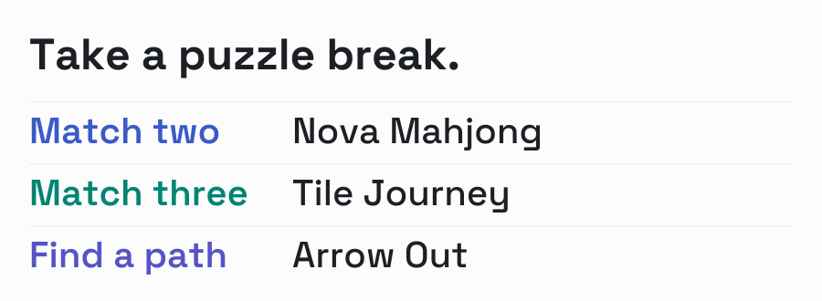

<a href="https://veryfunstudio.github.io/">
  <picture>
    <source media="(prefers-color-scheme: dark)" srcset="assets/playroom-dark.svg">
    
  </picture>
</a>

# VeryFun Studio

Small Android puzzle games, with room to think.

**[Play a Mahjong board →](https://veryfunstudio.github.io/)**

### Choose your puzzle

[All games](https://veryfunstudio.github.io/games)

**[Nova Mahjong For Seniors](https://veryfunstudio.github.io/games/nova-mahjong)** 
Match free pairs. Large tiles, no time limit, offline play.

**[Tile Journey](https://veryfunstudio.github.io/games/tile-journey)** 
Match three tiles and work through layered puzzles.

**[Arrow Out](https://veryfunstudio.github.io/games/arrow-out)** 
Trace the direction of each arrow and clear a path.

From the studio

[Studio notes](https://veryfunstudio.github.io/blog) — the decisions behind our games.

[About VeryFun Studio](https://veryfunstudio.github.io/about)

[Google Play](https://play.google.com/store/apps/developer?id=songxugang) &emsp; [Support](mailto:veryfunstudios@gmail.com) &emsp; [X](https://x.com/veryfunstudio)
