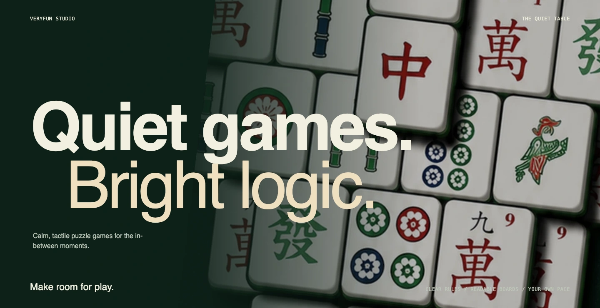
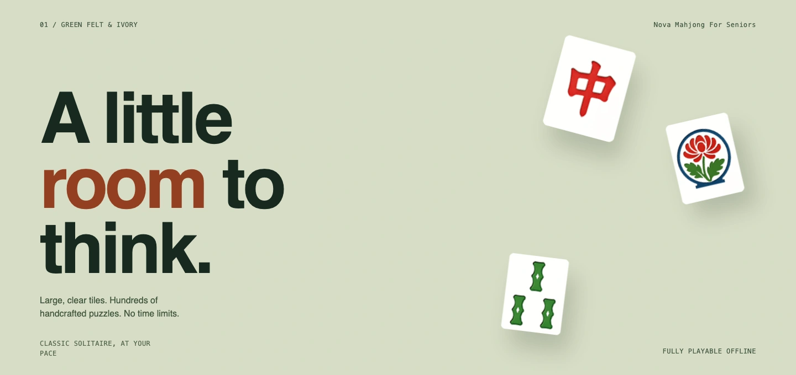
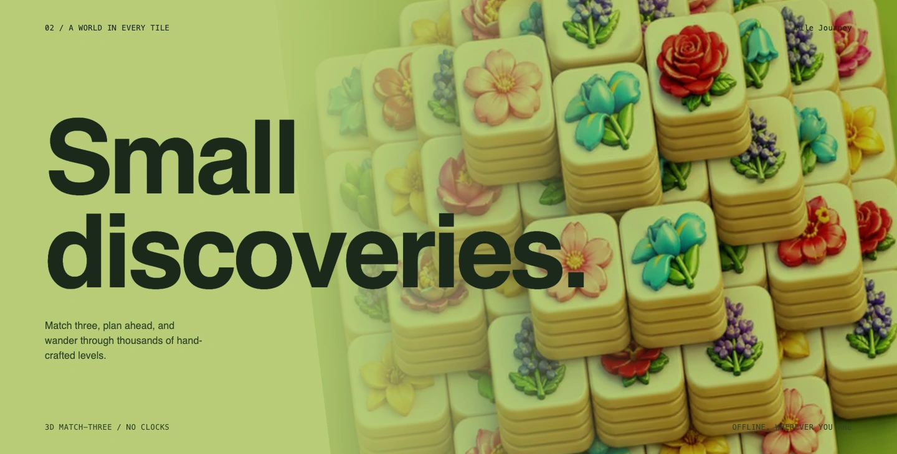
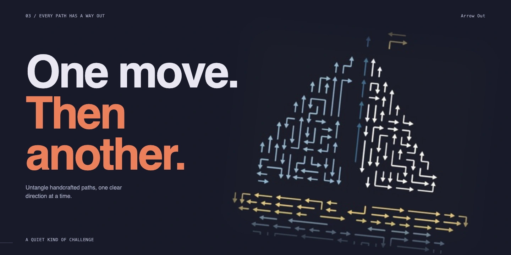
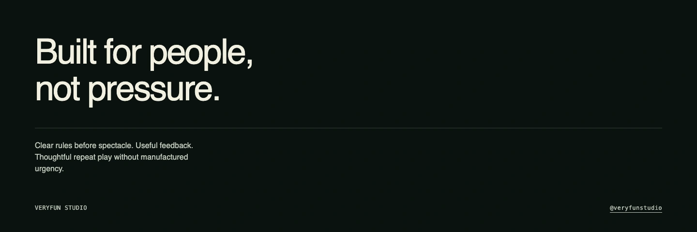

  <a href="https://veryfunstudio.github.io/">
    <picture>
      <source media="(max-width: 600px)" srcset="assets/v2/quiet-hero-mobile.webp">
      
    </picture>
  </a>

  <a href="https://veryfunstudio.github.io/games">Explore our games</a>
  &nbsp;&nbsp;&nbsp;
  <a href="https://veryfunstudio.github.io/blog">Studio Notes</a>
  &nbsp;&nbsp;&nbsp;
  <a href="https://play.google.com/store/apps/developer?id=Veryfun+Studio">Google Play</a>
  &nbsp;&nbsp;&nbsp;
  <a href="mailto:veryfunstudios@gmail.com">Contact</a>

<h2>Nova Mahjong For Seniors</h2>

  <a href="https://veryfunstudio.github.io/games/nova-mahjong">
    <picture>
      <source media="(max-width: 600px)" srcset="assets/v2/quiet-nova-mobile.webp">
      
    </picture>
  </a>

Large, clear tiles. Hundreds of handcrafted puzzles. No time limits. Fully playable offline. 
**[Play on Android](https://play.google.com/store/apps/details?id=com.veryfuncompany.mahjongjourney)** · [Discover Nova](https://veryfunstudio.github.io/games/nova-mahjong)

<h2>Tile Journey</h2>

  <a href="https://veryfunstudio.github.io/games/tile-journey">
    <picture>
      <source media="(max-width: 600px)" srcset="assets/v2/quiet-tile-mobile.webp">
      
    </picture>
  </a>

Match three, plan ahead, and wander through thousands of handcrafted levels. Play offline, wherever you are. 
**[Play on Android](https://play.google.com/store/apps/details?id=com.veryfun.tilejourney)** · [Begin the journey](https://veryfunstudio.github.io/games/tile-journey)

<h2>Arrow Out</h2>

  <a href="https://veryfunstudio.github.io/games/arrow-out">
    <picture>
      <source media="(max-width: 600px)" srcset="assets/v2/quiet-arrow-mobile.webp">
      
    </picture>
  </a>

Untangle handcrafted paths, one clear direction at a time. 
**[Play on Android](https://play.google.com/store/apps/details?id=com.veryfuncompany.kittyescape)** · [Find your way](https://veryfunstudio.github.io/games/arrow-out)

  <picture>
    <source media="(max-width: 600px)" srcset="assets/v2/quiet-outro-mobile.webp">
    
  </picture>

  <a href="https://veryfunstudio.github.io/">veryfunstudio.github.io</a>
  &nbsp;&nbsp;&nbsp;
  <a href="https://x.com/veryfunstudio">@veryfunstudio</a>
  &nbsp;&nbsp;&nbsp;
  <a href="mailto:veryfunstudios@gmail.com">Contact</a>

